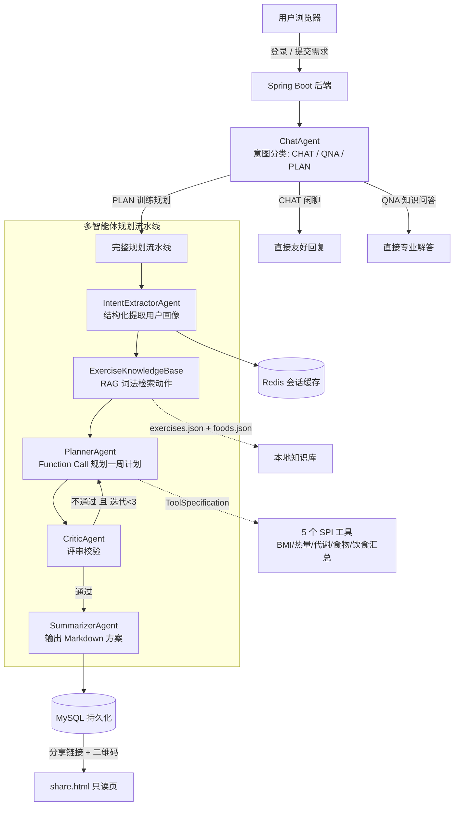

# 🏋️ FitAgent —— 基于多智能体协作的 AI 健身训练与营养助手

一个基于 **DeepSeek 大模型 + LangChain4j** 的 AI 健身教练应用。用户用自然语言描述身体情况与健身目标，后端通过「**意图分类 → 意图解析 → RAG 检索 → 规划 → 评审 → 汇总**」的多智能体流水线，生成个性化训练计划与营养建议；同时提供身体指标计算、饮食记录、训练打卡等工具，支持账号登录、会话历史与分享二维码。

> 🚀 **在线体验**：<http://47.243.8.223:8080>

---

## ✨ 核心特性

- **多智能体协作流水线**：5 个 Agent 分工——意图分类（闲聊 / 知识问答 / 训练规划三分类）、意图解析、规划、评审、汇总；Critic 评审不通过时自动回传意见重规划（最多 3 次，防死循环）。
- **Function Calling 工具调用**：通过 Java SPI 可插拔注册 5 个工具，让大模型在规划时自动调用 BMI / 热量 / 代谢 / 食物营养 / 饮食汇总计算，保证数值准确、不靠模型瞎猜。
- **RAG 检索增强**：本地健身动作库 + 食物营养库，词法检索；检索时**硬性排除**与用户伤病禁忌冲突、器械不可用的动作。
- **JSON Schema 强校验**：LLM 输出非法 JSON 时自动注入修正 prompt 重试，保障下游拿到结构化数据。
- **四大功能模块**：AI 对话、身体指标计算器（BMI/BMR/TDEE）、饮食工具（食物查询 + 每日记录）、训练打卡日志，顶部 Tab 一键切换。
- **账号体系**：手机号 + 密码（BCrypt 哈希）注册登录，支持扫码登录（自建二维码握手流程）。
- **会话管理**：会话历史分项目 / 置顶 / 重命名 / 归档 / 删除；训练方案可生成分享链接 + 二维码，他人扫码只读查看。
- **MySQL 持久化 + Redis 会话缓存**：任务与业务数据落库，会话上下文缓存减少重复 LLM 调用（Redis 不可用自动降级，不影响主链路）。
- **Docker 化部署**：多阶段构建（Maven 构建层 + JRE 运行层）+ Compose 编排 App / MySQL / Redis 三容器，已上线阿里云轻量应用服务器。

---

## 🧭 整体架构

```
浏览器 ── POST /api/task/submit ──▶ TaskController ──▶ AgentOrchestrator（@Async 后台线程）
                                                              │
                                      ┌───────────────────────┴───────────────────────┐
                                      ▼                                                   ▼
                          ChatAgent 意图分类（CHAT / QNA / PLAN）            Redis 会话缓存 + MySQL 任务持久化
                                      │
                     ┌────────────────┼─────────────────┐
                     ▼                ▼                 ▼
                  CHAT 闲聊       QNA 知识问答        PLAN 训练规划（走完整流水线）
                     │                │                 │
                     ▼                ▼                 ▼
                  直接友好回复      直接专业解答      IntentExtractorAgent 意图解析
                                                      → ExerciseKnowledgeBase RAG 检索动作
                                                      → PlannerAgent（Function Call）规划
                                                      → CriticAgent 评审（不通过则重规划）
                                                      → SummarizerAgent 输出 Markdown
```

### Mermaid 架构图



---

## 🛠 技术栈

| 层 | 技术 |
|---|---|
| 语言 / 框架 | Java 17 · Spring Boot 3.5 · Spring MVC · Spring Data JPA · Spring Data Redis |
| 大模型 | DeepSeek 在线 API（`deepseek-chat`，OpenAI 兼容 + Function Call） |
| LLM SDK | LangChain4j 1.2.0（OpenAI 兼容客户端指向 DeepSeek，唯一大模型 SDK） |
| 存储 | MySQL 8 · Redis 7 |
| JSON 校验 | networknt json-schema-validator |
| 安全 | Spring Security Crypto（BCrypt） |
| 前端 | 原生 JavaScript + 自托管 Tailwind CSS + marked.js + qrcode.js |
| 部署 | Docker 多阶段构建 + Docker Compose · 阿里云轻量应用服务器 |

---

## 📱 功能模块

| 模块 | 说明 |
|---|---|
| **AI 对话** | 多智能体生成训练计划 / 解答健身营养问题，支持会话历史、分享 |
| **身体指标计算器** | 输入性别 / 年龄 / 身高 / 体重 / 活动量，计算 BMI（含分级）、BMR、TDEE，给出减脂 / 维持 / 增肌三档热量与宏量建议，可保存档案 |
| **饮食工具** | 食物营养查询（热量 / 蛋白质 / 碳水 / 脂肪），每日饮食记录与全天营养汇总 |
| **训练打卡日志** | 记录每次训练的部位 / 动作 / 重量 / 组数次数 / 感受，统计累计与本周频次 |

---

## 🤖 Function Calling 工具

通过 Java SPI 注册（`META-INF/services/com.fitness.agent.tool.AgentTool`），大模型在规划时按需调用：

| 工具名 | 作用 |
|---|---|
| `calculate_bmi` | 计算 BMI 及分级 |
| `recommend_calories` | 每日目标热量推荐 |
| `calculate_metabolism` | 计算 BMI / BMR / TDEE 与三档目标热量 |
| `food_nutrition` | 查询某食物指定重量的营养数据 |
| `calculate_diet_total` | 汇总一组食物的热量与三大营养素 |

> 扩展新工具：实现 `AgentTool` 接口，并在 SPI 登记文件中追加一行即可自动发现。

---

## 📁 目录结构

```
src/main/java/com/fitness/agent/
├── FitnessAgentApplication.java     # 启动类（@EnableAsync）
├── config/                          # LangChain4j / 线程池 / 鉴权 / 配置属性
├── controller/                      # Auth / Task / Conversation / Project /
│                                    # BodyMetrics / Diet / WorkoutLog / FileUpload
├── service/
│   ├── AgentOrchestrator.java       # 多智能体流水线编排（@Async）
│   ├── ChatAgent.java               # 意图分类（CHAT / QNA / PLAN）+ 直接回复
│   ├── IntentExtractorAgent.java    # 意图解析（结构化用户画像）
│   ├── PlannerAgent.java            # 规划（Function Call + RAG）
│   ├── CriticAgent.java             # 评审
│   ├── SummarizerAgent.java         # Markdown 汇总
│   ├── ExerciseKnowledgeBase.java   # 动作知识库 + 词法检索
│   ├── FoodCatalog.java             # 食物营养库
│   ├── NutritionCalculator.java     # BMI/BMR/TDEE 纯计算
│   └── ...                          # 各业务 Service / 用户数据聚合
├── agent/                           # JsonExtractor / JsonSchemaValidator / AgentToolCaller
├── statemachine/                    # TaskStatus / TaskStateMachine
├── tool/                            # AgentTool(SPI) + 5 个工具实现
├── model/                           # 实体 + DTO
├── repository/                      # Spring Data JPA 仓储
├── auth/                            # 登录鉴权（UserContext / Interceptor）
├── exception/                       # BusinessException / GlobalExceptionHandler
└── util/JsonUtil.java

src/main/resources/
├── application.yml                  # 端口 / DB / Redis / DeepSeek / Agent 参数
├── prompts.yml                      # 各 Agent 提示词（改文案不碰代码）
├── schema/*.json                    # Profile / Plan / Critic 的 JSON Schema
├── data/exercises.json              # 健身动作知识库
├── data/foods.json                  # 食物营养库
├── META-INF/services/...AgentTool   # SPI 工具登记
└── static/                          # index / login / confirm / share + css + js
```

---

## 🚀 快速开始（本地）

### 1. 环境要求

- JDK 17+
- Maven 3.6+
- Docker（推荐，一键启动全部中间件）

### 2. 配置密钥

```bash
# 复制环境变量模板
cp .env.example .env

# 编辑 .env，填入你的 DeepSeek API Key
DEEPSEEK_API_KEY=sk-你的key
```

> `.env` 已在 `.gitignore` 中，不会提交到 git。

### 3. 一键启动（推荐）

```bash
docker compose up -d --build
```

会自动构建镜像并启动 **App + MySQL + Redis** 三个容器，浏览器打开 <http://localhost:8080>。

### 4. 本地开发（只启动中间件，App 用 Maven 跑）

```bash
docker compose up -d mysql redis   # 只启动 MySQL + Redis
mvn spring-boot:run                # 本地运行 App
```

---

## 📦 部署上线

项目已通过 Docker 部署上线，地址 <http://47.243.8.223:8080>。

```bash
# 1. 服务器上准备 .env（含 DEEPSEEK_API_KEY、DB_PASSWORD）
# 2. 构建并后台启动三容器
docker compose up -d --build

# 3. 查看状态 / 日志
docker compose ps
docker compose logs -f app
```

数据持久化在 Docker 数据卷（`mysql-data` / `redis-data` / `uploads-data`），`docker compose down` 不会丢数据，`down -v` 才会清空。

---

## 🔌 REST 接口

| 模块 | 方法 | 路径 | 说明 |
|---|---|---|---|
| 认证 | POST | `/api/auth/register` `/api/auth/login` | 注册 / 登录 |
| 认证 | GET | `/api/auth/me` | 当前用户信息 |
| 认证 | POST | `/api/auth/qr/create` · `/qr/status` · `/qr/confirm` | 扫码登录 |
| 训练 | POST | `/api/task/submit` | 提交健身需求，返回 `sessionId` |
| 训练 | GET | `/api/task/{sessionId}` | 查询进度（前端轮询） |
| 训练 | GET | `/api/task/{sessionId}/result` | 获取完整训练方案 |
| 训练 | GET | `/api/task/{sessionId}/share` | 分享只读视图（不含个人信息） |
| 身体指标 | POST | `/api/body/calculate` | 计算 BMI/BMR/TDEE |
| 身体指标 | GET/POST | `/api/body/profile` | 查询 / 保存身体档案 |
| 饮食 | GET | `/api/diet/food/search?q=` | 食物营养查询 |
| 饮食 | POST | `/api/diet/record` | 添加饮食记录 |
| 饮食 | GET | `/api/diet/summary?date=` | 当日营养汇总 |
| 训练打卡 | POST | `/api/workout` | 新增打卡 |
| 训练打卡 | GET | `/api/workout/stats` | 打卡统计 |
| 会话 | GET/POST | `/api/conversation` | 会话列表 / 新建 |
| 项目 | GET/POST | `/api/project` | 项目分组 |

提交示例：

```bash
curl -X POST http://localhost:8080/api/task/submit \
  -H "Content-Type: application/json" \
  -d '{"message":"我身高175cm，体重90kg，男，膝盖有旧伤不能深蹲和跑步，家里有哑铃和弹力带，每周能练4天，目标减脂，每次训练45分钟以内。"}'
```

---

## 🧪 示例：一条完整链路

**输入：**

> 我身高 175cm，体重 90kg，男，膝盖有旧伤不能深蹲和跑步，家里有哑铃和弹力带，每周能练 4 天，目标减脂，每次训练 45 分钟以内。

**预期链路：**

1. **意图分类**：识别为「训练规划」（PLAN）。
2. **意图解析**：提取 `heightCm=175`、`weightKg=90`、`gender=男`、`injuries=["膝伤"]`、`equipment=["哑铃","弹力带"]`、`daysPerWeek=4`、`goal=减脂`、`durationMinutes=45`。
3. **RAG 检索**：排除所有标记「膝伤」的动作（深蹲、弓步、开合跳、波比跳等）及杠铃/器械动作，保留臀桥、站姿提踵、平板支撑等膝友好动作。
4. **规划**：可调用 `calculate_bmi`（BMI≈29.4 超重）、`calculate_metabolism` 等工具，生成 4 天/周、每次 ≤45min 的减脂计划。
5. **评审**：校验无禁忌动作、强度合理、负荷循序渐进。
6. **汇总**：输出含「训练安排 / 饮食建议 / 注意事项」的 Markdown 方案。

---

## ❓ 常见问题

- **启动报数据库连接失败**：先 `docker compose up -d mysql`，确认 3306 端口未占用。
- **提交后一直「规划中」**：检查 `DEEPSEEK_API_KEY` 是否正确、能否访问 `https://api.deepseek.com`；查看日志 `com.fitness.agent`。
- **Redis 不可用**：项目已做容错，Redis 挂了自动降级为纯 MySQL，不影响主链路。
- **想换模型 / 调温度**：改 `application.yml` 的 `deepseek.*` 或 `agent.*`；想改提示词直接改 `prompts.yml`。
- **新增工具**：实现 `AgentTool` 接口，在 `META-INF/services/com.fitness.agent.tool.AgentTool` 中登记即可。

---

## 📄 免责声明

本项目用于技术演示与学习，内置训练计划与营养建议由大模型生成，**不构成医疗或专业健身建议**。有伤病或特殊健康状况者请在专业人士指导下训练。
